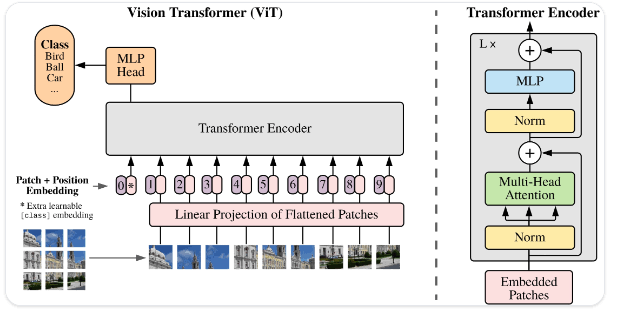

# 🔬 ViT + PSO for Malaria Cell Classification

**TL;DR:** A pre-trained Vision Transformer (`google/vit-base-patch16-224`) fine-tuned to classify red blood cell images as **Parasitized** or **Uninfected**, with learning rate and batch size searched by Particle Swarm Optimization (PSO). The best manual setting reached **97.71%** test accuracy and the PSO-tuned setting **97.97%** on the same 2,756 unseen images. PSO landed on almost the same setting as the best manual run (batch size 32, learning rate 9.2×10⁻⁵ vs 10⁻⁴), so it mainly **confirms** the manual baseline. The +0.26 point gain is 7 images and falls within run-to-run noise (see [Limitations](#6-limitations)).

| | |
|---|---|
| **Tools** | Python, PyTorch, Hugging Face Transformers, pyswarms, scikit-learn, Kaggle (GPU) |
| **Task** | Binary image classification (medical imaging) |
| **Type** | Individual project, for learning and research only, not a diagnostic tool |


*Generic Vision Transformer diagram. Source: [Original ViT architecture (extracted from (Dosovitskiy et al., 2020))](https://arxiv.org/abs/2010.11929)*

---

## 1. Objective
1. Fine-tune a Vision Transformer to detect malaria-infected cells.
2. Establish a baseline by manually testing optimizers (Adam, AdamW), learning rates and batch sizes.
3. Check whether PSO can find a better learning rate and batch size than the manual search.

## 2. Data & Model
* **Dataset:** [Cell Images for Detecting Malaria (Kaggle)](https://www.kaggle.com/datasets/iarunava/cell-images-for-detecting-malaria), 27,558 images, perfectly balanced (13,779 Parasitized, 13,779 Uninfected).
* **Split:** stratified random split by image, 80% train (22,046) / 10% validation (2,756) / 10% test (2,756, with 1,378 per class), `random_state=42`. The test set is used once, at the end.
* **Model:** [`google/vit-base-patch16-224`](https://huggingface.co/docs/transformers/en/model_doc/vit#vision-transformer-vit) with the classification head replaced by a 2-class head.
* **Augmentation (train only):** random resized crop (scale 0.8–1.0), rotation ±20°, color jitter, horizontal and vertical flips.
* **Training:** up to 50 epochs, early stopping on validation accuracy (patience 5, minimum improvement 0.0001), and the best checkpoint is evaluated on the test set.

## 3. Manual Baseline
Four runs, all with the same split, augmentation and early stopping:

| Test | Optimizer | Learning rate | Batch size | Best val. accuracy | Test accuracy | Notebook |
| :---: | :--- | :---: | :---: | :---: | :---: | :--- |
| 1 | Adam | 10⁻⁴ | 32 | 97.64% | **97.71%** | `sc/ViT-Adam1.ipynb` |
| 2 | AdamW (wd 0.01) | 10⁻⁴ | 32 | 97.31% | 97.46% | `sc/ViT-AdamW1.ipynb` |
| 3 | AdamW (wd 0.01) | 10⁻³ | 64 | 96.08% | 96.12% | `sc/ViT-AdamW2.ipynb` |
| 4 | Adam | 10⁻³ | 64 | 96.08% | 95.75% | `sc/ViT-Adam2.ipynb` |

The two settings tested differ in learning rate **and** batch size at the same time, so this grid shows that (10⁻⁴, 32) beat (10⁻³, 64), but not which of the two changes made the difference. Adam and AdamW gave similar results at the same settings.

## 4. PSO Hyperparameter Search
Notebook: `sc/with-PSO/pso-tuning.ipynb`

| Setting | Value |
| :--- | :--- |
| Library / algorithm | `pyswarms` GlobalBestPSO |
| Budget | 5 particles × 5 iterations = **25 trials**, 3 epochs per trial |
| PSO coefficients | c1 = 2.0, c2 = 2.0, w = 0.7 |
| Search space | Learning rate 10⁻⁶ – 10⁻³ (linear scale); batch size 16 – 64, snapped to the nearest of {16, 32, 64} |
| Optimizer in trials | Adam |
| Data in trials | Stratified 50% subset (13,779 images): 11,023 train / 2,756 validation |
| Fitness | 1 − best **validation** accuracy over the 3 epochs (the test set is not used in tuning) |

**Search progress** (best validation accuracy found so far, by iteration): 96.48% → 96.48% → 96.70% → 96.95% → **97.13%**.

**Result:** learning rate **9.2×10⁻⁵**, batch size **32** (raw PSO position 42.8, snapped to 32). The best trial was the last one evaluated, so the search was still improving when its budget ended.

**Final training** (`sc/with-PSO/ViT-PSO.ipynb`): full training set with the PSO setting (Adam, 9.2×10⁻⁵, batch 32). Early stopping triggered at epoch 15, the best checkpoint (epoch 10, validation accuracy 97.46%) was evaluated on the test set.

## 5. Results
Both models on the same test set (2,756 images, 1,378 per class):

| | Manual best (Test 1) | PSO-tuned |
| :--- | :---: | :---: |
| Setting | Adam, 10⁻⁴, batch 32 | Adam, 9.2×10⁻⁵, batch 32 |
| **Test accuracy** | **97.71%** (2,693 / 2,756) | **97.97%** (2,700 / 2,756) |
| Approx. 95% CI (±1.96 SE) | 97.16 – 98.27% | 97.44 – 98.49% |
| Errors | 63 | 56 |
| Infected cells missed (false negatives) | 40 | 37 |
| Healthy cells flagged (false positives) | 23 | 19 |
| Parasitized recall / precision | 97.10% / 98.31% | 97.31% / 98.60% |
| Uninfected recall / precision | 98.33% / 97.13% | 98.62% / 97.35% |

Confusion matrix (PSO-tuned model):

| | Predicted Parasitized | Predicted Uninfected |
| :--- | :---: | :---: |
| **Actual Parasitized** | 1,341 | 37 |
| **Actual Uninfected** | 19 | 1,359 |

**Interpretation**
* Both models are strong and close to each other. The PSO-tuned model makes **7 fewer errors** than the best manual model.
* That gap is small compared with the uncertainty: the confidence intervals overlap, each setting was trained once without a fixed random seed, and validation accuracy moves by up to about 1.8 points between epochs within a single run. So the data does **not** show that PSO is better, only that it is at least as good.
* PSO reached the same region as the manual search (batch 32, learning rate around 10⁻⁴) using an independent method, which supports the manual choice.
* For malaria screening the cost of a missed infection is higher than a false alarm, so **Parasitized recall (97.3%, 37 missed cells)** is the metric to watch.

## 6. Limitations
* **Single run per setting, no fixed seed in the final training notebooks.** Differences below roughly 0.5 points should not be treated as real. Repeated runs with several seeds (mean ± std) would settle it.
* **Small search budget:** 25 trials with 3-epoch proxy training on half the data, learning rate searched on a linear scale (all starting particles were at 2×10⁻⁴ or higher), and no random-search baseline with the same budget. The best trial came last, so the search had not converged.
* **Tuning and final split differ.** Tuning used its own 50% subset and 80/20 split, so images seen during tuning can also appear in the final test set. Only two hyperparameters were tuned, so the effect is likely small, but a single shared split would be cleaner.
* **Image-level split, not patient-level.** The dataset comes from a limited number of patients and has no patient IDs, so cells from the same patient can appear in both train and test. Accuracy on new patients or other microscopes is likely lower. There is no external validation set.
* **Research use only.** This is not a validated diagnostic tool.
* **Known notebook issues:** the last plotting cell of `pso-tuning.ipynb` raises an error (wrong pyswarms function name), and its per-iteration summary table shows incorrect learning rate / batch size columns. Neither affects the PSO result; the figures in Section 4 come from the optimizer log.

## 7. Possible Next Steps
* Repeat each configuration with 3–5 seeds and report mean ± std; test the difference with a paired test (e.g., McNemar) on per-image predictions.
* Search the learning rate on a log scale and compare PSO against random search with the same 25-trial budget.
* Use one fixed split for tuning and evaluation, and a patient-level split if patient IDs are available.
* Tune the decision threshold to raise Parasitized recall, and inspect errors with attention maps or Grad-CAM.

## 8. Repository Structure
```
├── README.md
├── LICENSE.md                       # MIT
├── assets/
│   └── vit.jfif                     # ViT illustration
└── sc/
    ├── ViT-Adam1.ipynb              # Test 1: Adam, 1e-4, batch 32
    ├── ViT-AdamW1.ipynb             # Test 2: AdamW, 1e-4, batch 32
    ├── ViT-AdamW2.ipynb             # Test 3: AdamW, 1e-3, batch 64
    ├── ViT-Adam2.ipynb              # Test 4: Adam, 1e-3, batch 64
    └── with-PSO/
        ├── pso-tuning.ipynb         # PSO search (25 trials)
        └── ViT-PSO.ipynb            # Final training + test evaluation with PSO setting
```

**To reproduce:** the notebooks were run on Kaggle with a GPU and the dataset attached (paths point to `/kaggle/input/cell-images-for-detecting-malaria/...`). Run `pso-tuning.ipynb` first (it installs `pyswarms`), then `ViT-PSO.ipynb`. Required libraries: `torch`, `torchvision`, `transformers`, `scikit-learn`, `pyswarms`, `seaborn`, `matplotlib`.
